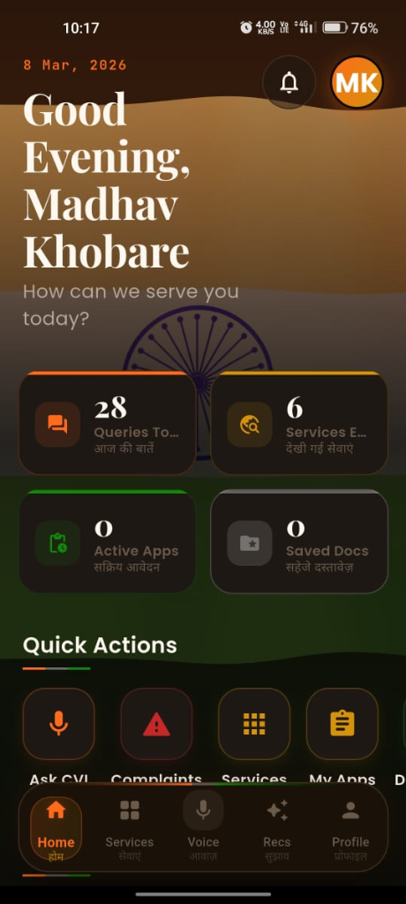
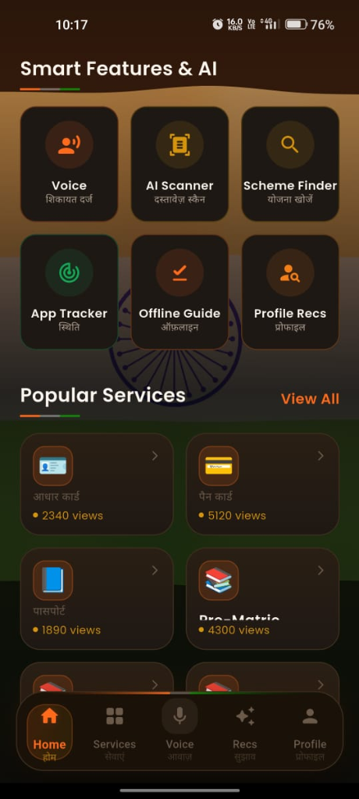
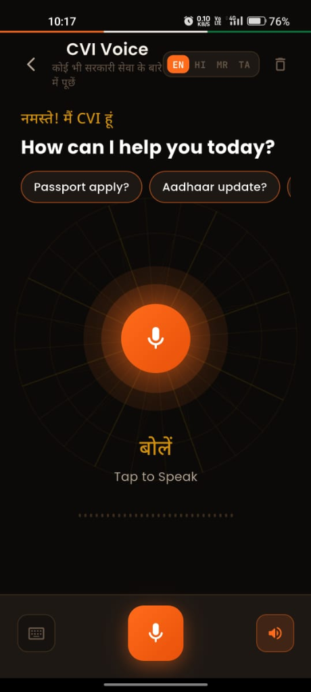
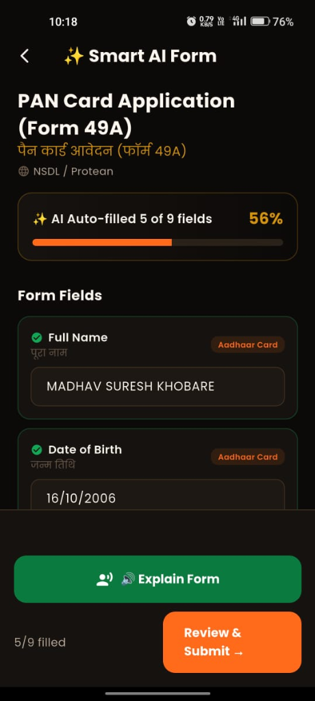

# Civic Voice - CVI

<div align="center">


-FF9900?style=for-the-badge&logo=amazonaws&logoColor=white)


<br/>

> **"Bridging the gap between citizens and the services that matter most."**

Civic Voice is a modern Flutter application designed to empower every citizen of Bharat by providing a centralized, voice-first platform for navigating government services, discovering welfare schemes, and receiving AI-powered guidance, all in their language.

</div>

---

## Overview

Navigating government services in India is often complex, inaccessible, and overwhelming. **Civic Voice** changes that. By combining a clear user interface, a conversational AI assistant (CVI), multilingual support, and a robust AWS cloud backend, Civic Voice delivers an accessible digital experience to every citizen, from metros to villages.

---

## Screenshots

| Splash and Welcome | Citizen Dashboard | Services and AI Features | CVI Voice Assistant | Smart AI Form Auto-Fill |
| :---: | :---: | :---: | :---: | :---: |
|  |  |  |  |  |
| Voice-first onboarding with Bharat theme | Personalized metrics, queries count, and quick actions | AI Scanner, Scheme Finder, and popular public services | Multilingual voice assistance (EN, HI, MR, TA) | Auto-filling Form 49A using verified Aadhaar data |

- **Splash and Welcome**: Voice-first onboarding screen ("Jago Bharat Jago") designed for citizens across Bharat.
- **Citizen Dashboard**: Live metrics, service activity tracking, and quick actions for grievances, schemes, and applications.
- **Services and AI Features**: Centralized catalog of government schemes, AI document scanner, scheme finder, and offline guides.
- **CVI Voice Assistant**: Multilingual voice conversational interface powered by Amazon Bedrock with support for English, Hindi, Marathi, and Tamil.
- **Smart AI Form Auto-Fill**: Automated form completion (e.g., PAN Form 49A) using verified documents from the citizen vault.

---

## Key Features

### CVI - Your AI Civic Assistant
A completely custom, intelligent voice and text assistant powered by **Amazon Bedrock (Meta Llama 3)**. Ask questions about government schemes, eligibility, documentation, and procedures in both **English and Hindi**, and receive accurate, contextual answers in seconds.

### Government Services Hub
A comprehensive, searchable directory of public services: **Aadhaar, PAN, Passport, Ration Card, Driving License, and more**, complete with step-by-step guides, required documents, timelines, fee structures, and official application links.

### AI Eligibility Checker
An intelligent, multi-step flow that analyses your profile data and tells you exactly which government schemes you qualify for, with a **Civic Confidence Gauge** scoring your eligibility in real-time.

### Smart Document Vault
A biometric-secured, encrypted personal vault to safely store, manage, and retrieve your critical documents (Aadhaar, PAN, certificates). Features **AI-powered scanning** and automatic inference of document fields.

### Auto-Form Assistant
A guided, voice-enabled form-filling flow that pre-populates government application forms using data from your Document Vault and Citizen Profile, then launches a **Smart Browser** for seamless in-app guided submission.

### Citizen Profile and Gamification
A centralized digital citizen profile to manage personal information and family members, track application statuses, and earn **achievements and badges** as you complete civic tasks.

### Office Locator
Locate the nearest government offices with GPS-powered maps and direct navigation links, making in-person visits effortless.

### Smart Notifications and Reminders
Stay on top of application deadlines, scheme expiry dates, and important announcements with intelligent, scheduled local notifications.

### Offline-First Guidance
A curated offline knowledge base ensures core service information and emergency guidance remain accessible even without an internet connection.

---

## Technology Stack and Cloud Backend

| Layer | Technology | Purpose |
|---|---|---|
| **Framework** | Flutter 3.27+ / Dart 3.6+ | Cross-platform mobile & desktop UI |
| **AWS Region** | `ap-south-1` (Mumbai) | Low latency for users across India |
| **Backend Orchestration** | AWS Amplify (Gen 1 CLI) | CloudFormation, Auth, API & Storage pipelines |
| **Authentication** | Amazon Cognito User & Identity Pools | Email / Phone SRP sign-in, MFA, and Guest auth |
| **GraphQL API** | AWS AppSync + Amazon DynamoDB | Scalable multi-model GraphQL API (`User`, `UserDocument`, `CitizenProfile`) |
| **Document Storage** | Amazon S3 | Secure private/public citizen document storage |
| **AI Assistant** | Amazon Bedrock (Meta Llama 3) | Generative reasoning via AWS Lambda & API Gateway |
| **Voice** | `speech_to_text` + `flutter_tts` | Client-side STT & bilingual TTS |
| **State Management** | Provider `^6.1.2` | Reactive client state |
| **Routing** | GoRouter `^17.1.0` | Deep linking and declarative navigation |

---

## Architecture Overview

Civic Voice follows a **Feature-First architectural pattern** on the Flutter client, backed by AWS infrastructure in Mumbai (`ap-south-1`).

```
civic_voice/
├── lib/
│   ├── core/                  # Theme, routing, services, AI reasoning engine
│   ├── features/              # Modular feature screens (auth, dashboard, services, voice)
│   ├── models/                # Generated Amplify models & data structures
│   ├── providers/             # State management controllers (Auth, Language, Voice)
│   ├── services/              # Business logic abstraction layers
│   ├── widgets/               # Reusable, branded UI components
│   └── amplifyconfiguration.dart # AWS Amplify client configuration
├── assets/                    # Lottie animations, images, icons, data (CSV)
├── docs/                      # Architectural documentation and screenshots
│   └── screenshots/           # Application screenshots for documentation
└── amplify/                   # AWS Amplify backend cloud definition
```

---

## Getting Started

### Prerequisites

- [Flutter SDK](https://flutter.dev/docs/get-started/install) (`>= 3.27.0`)
- [Dart SDK](https://dart.dev/get-dart) (`>= 3.6.0`)
- Node.js & npm (`>= 18`)
- [Amplify CLI](https://docs.amplify.aws/cli/start/install/) (`npm install -g @aws-amplify/cli`)
- AWS CLI configured with credentials in `ap-south-1`

### Setup and Run

1. **Clone repository:**
   ```bash
   git clone https://github.com/om29dev/civic_voice.git
   cd civic_voice
   ```

2. **Install Flutter dependencies:**
   ```bash
   flutter pub get
   ```

3. **Initialize or Pull Amplify Backend:**
   ```bash
   amplify pull
   ```
   *The backend is pre-configured and deployed in `ap-south-1` (Mumbai).*

4. **Run the Application:**
   ```bash
   flutter run
   ```

5. **Run Tests:**
   ```bash
   flutter test
   ```

---

## License

Distributed under the MIT License. See `LICENSE` for details.

<div align="center">
  <i>Built for Bharat: empowering every citizen, one voice at a time.</i>
</div>
