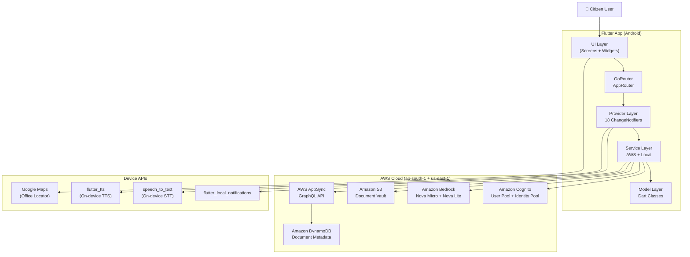
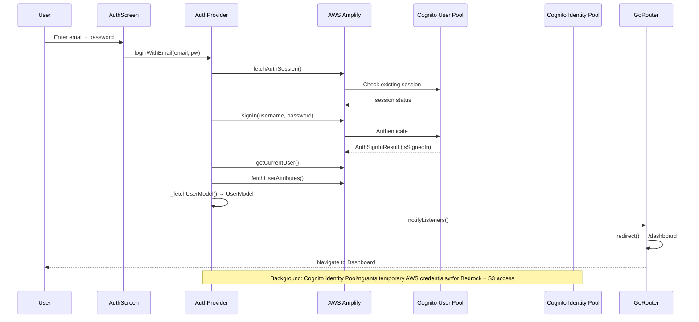
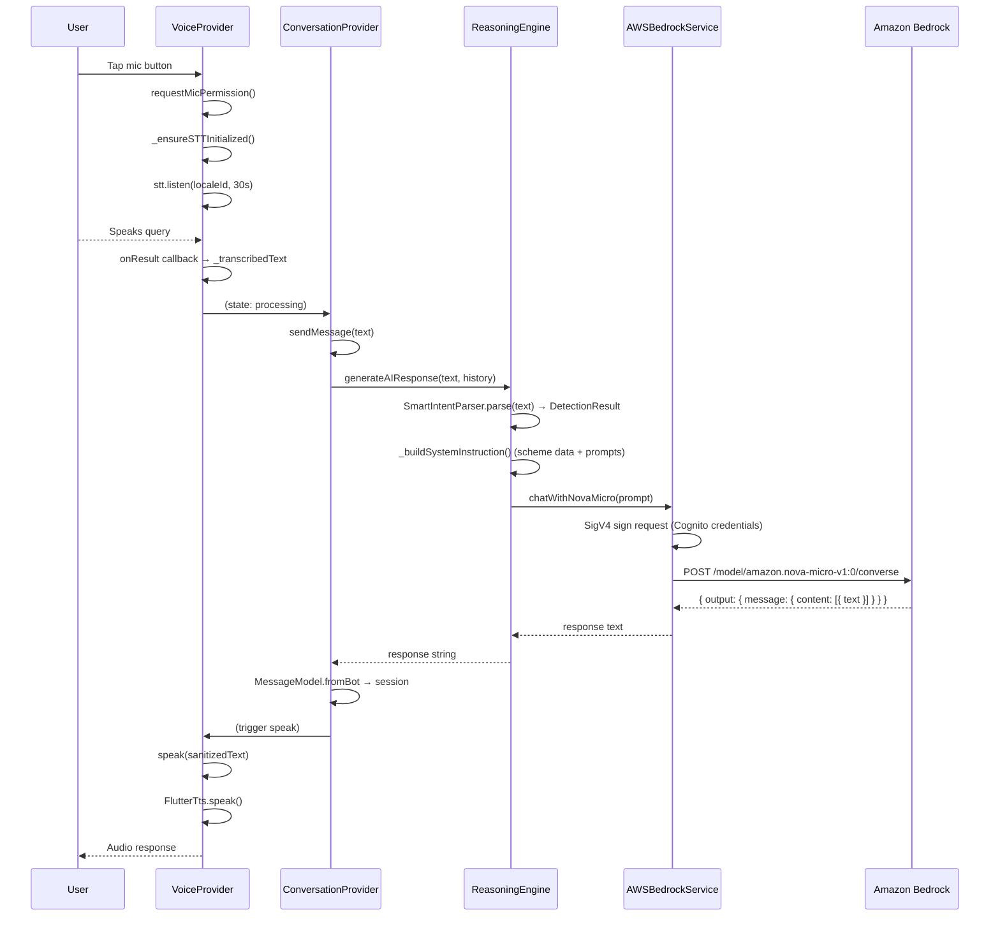
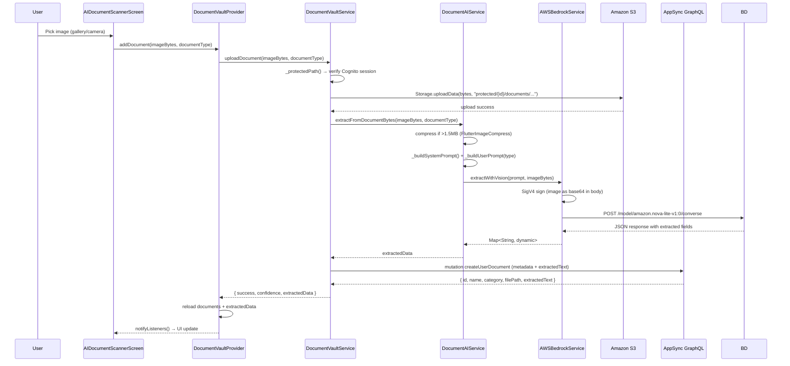
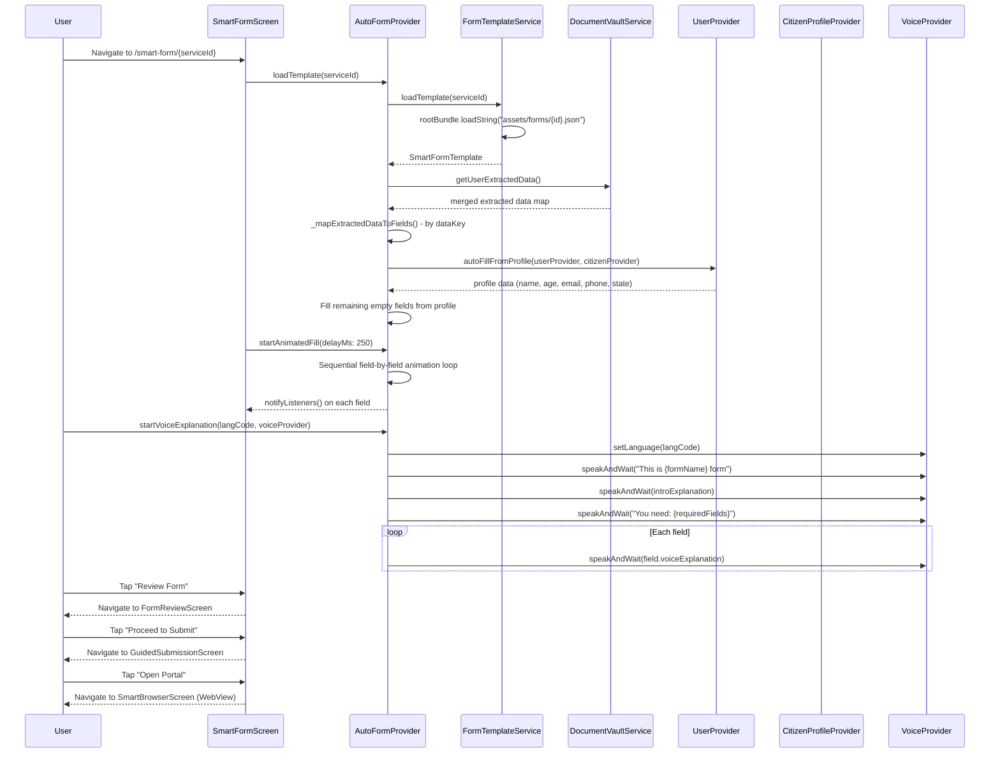
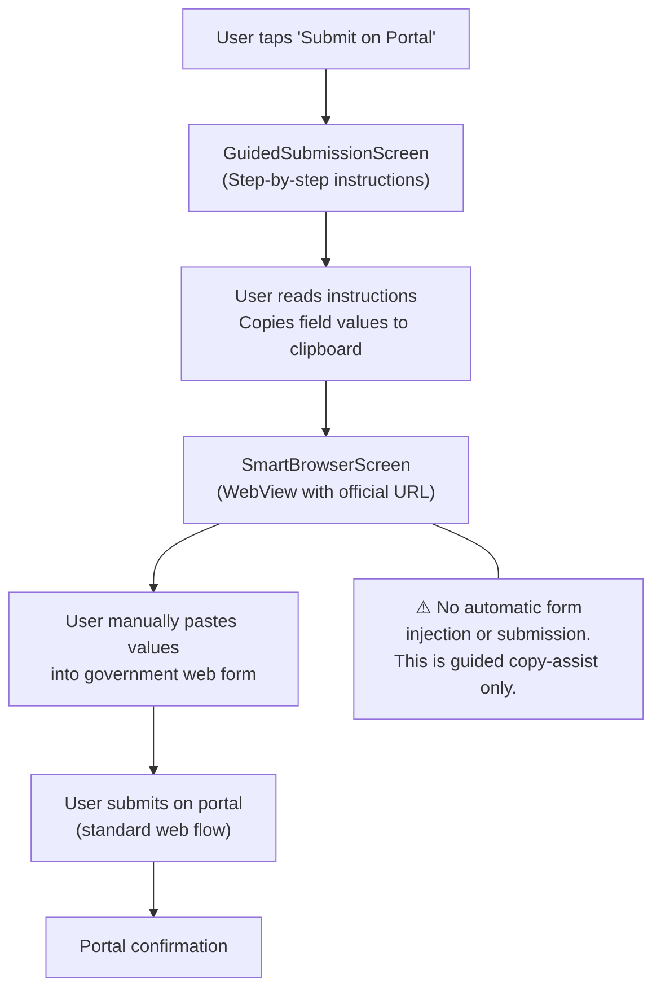
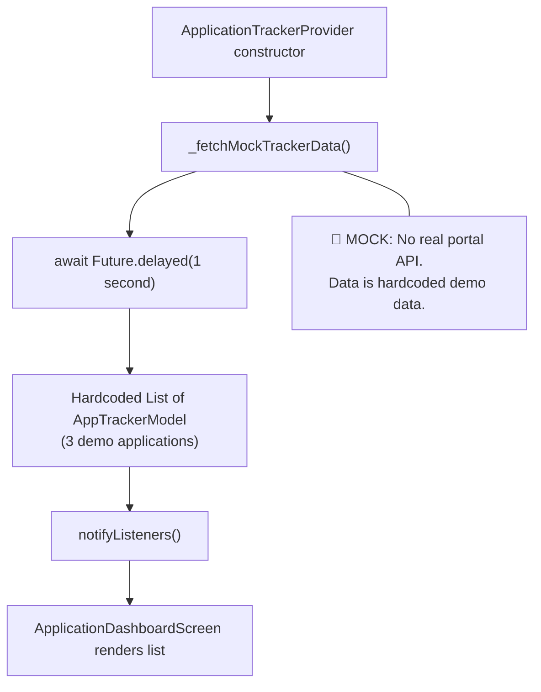
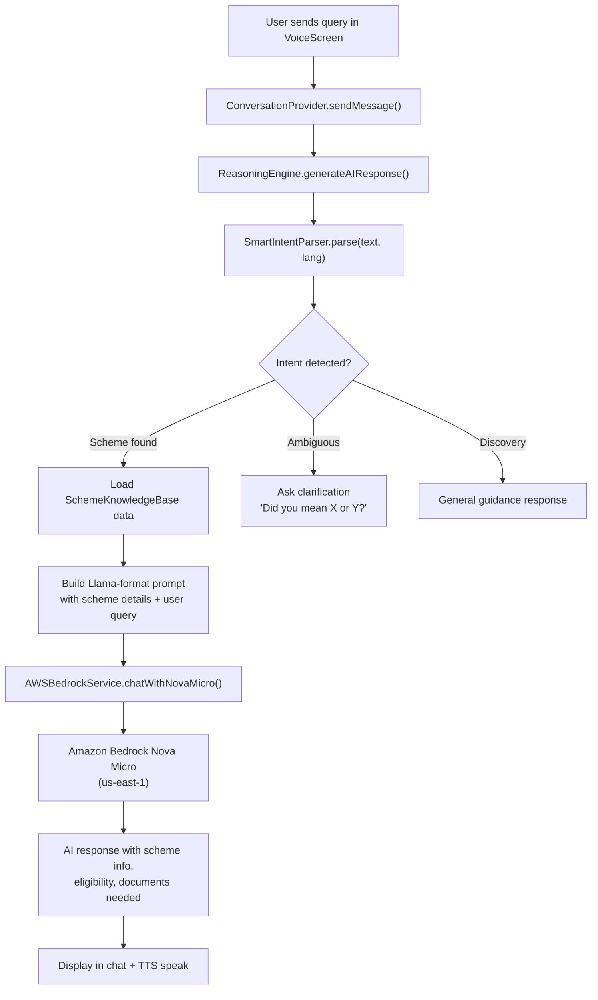

# Technical Architecture — Civic Voice

## 1. Overall Architecture

Civic Voice follows a **layered Flutter architecture** with clear separation of concerns:

```
┌─────────────────────────────────────────────────────────┐
│                    Flutter UI Layer                      │
│  Screens → Widgets → CVIBottomNav → GoRouter Shell       │
├─────────────────────────────────────────────────────────┤
│              Provider State Management Layer             │
│  AuthProvider │ VoiceProvider │ AutoFormProvider │ ...   │
├─────────────────────────────────────────────────────────┤
│                    Service Layer                         │
│  AWSBedrockService │ DocumentVaultService │ ReasoningEngine │
├─────────────────────────────────────────────────────────┤
│                    Data / Model Layer                    │
│  UserModel │ CVIDocument │ SmartFormTemplate │ ...       │
├─────────────────────────────────────────────────────────┤
│                  AWS Cloud Backend                       │
│  Cognito │ Bedrock │ S3 │ DynamoDB(AppSync) │ Amplify   │
└─────────────────────────────────────────────────────────┘
```

## 2. System Architecture Diagram



## 3. Authentication Flow



## 4. Voice Assistant Pipeline



## 5. Document Scanning & Extraction



## 6. Smart Form Auto-Fill Pipeline



## 7. Government Portal Submission Flow



## 8. Application Tracking Flow



## 9. Scheme Recommendation Flow



## 10. Provider Architecture Map

```mermaid
graph TD
    MP["MultiProvider root (main.dart)"]
    
    MP --> AuthP["AuthProvider\n(Cognito session)"]
    MP --> VP["VoiceProvider\n(STT + TTS)"]
    MP --> ConvP["ConversationProvider\n(Chat + AI)"]
    MP --> LP["LanguageProvider\n(en/hi/mr/ta)"]
    MP --> UP["UserProvider\n(user profile data)"]
    MP --> SP["ServicesProvider\n(gov service catalog)"]
    MP --> DVP["DocumentVaultProvider\n(S3 + DynamoDB)"]
    MP --> AFP["AutoFormProvider\n(form auto-fill)"]
    MP --> ATP["ApplicationTrackerProvider\n(mock apps)"]
    MP --> SDP["SchemeDiscoveryProvider\n(mock schemes)"]
    MP --> ECP["EligibilityCheckerProvider\n(mock eligibility)"]
    MP --> CPP["CitizenProfileProvider\n(detailed citizen data)"]
    MP --> DSP["DocumentScannerProvider\n(scanner state)"]
    MP --> NP["NotificationProvider\n(local notifications)"]
    MP --> AP["AnalyticsProvider\n(local analytics)"]
    MP --> AcP["AccessibilityProvider\n(text scale + color)"]
    MP --> OGP["OfflineGuidanceProvider\n(offline content)"]
    MP --> CompP["ComplaintProvider\n(voice complaints)"]
    
    ConvP --> VP
    AFP --> DVP
    AFP --> UP
    AFP --> CPP
    AFP --> VP
    AuthP --> LP
```



## 11. Routing Architecture

**Router**: GoRouter ^17.1.0  
**Shell**: `_AppShell` wraps Dashboard/Services/Recommendations/Profile tabs with `CVIBottomNav`

### Route Map
```
/ (splash)
/onboarding
/auth
/dashboard          ← Shell tab 0
/services           ← Shell tab 1
/recommendations    ← Shell tab 3
/profile            ← Shell tab 4
/voice              ← push (tab 2 is shortcut)
/service/:id
/service/:id/eligibility
/notifications
/my-applications
/documents
/document-vault
/auto-fill/:serviceId
/smart-form/:serviceId    ← NEW auto_form module
/form-review
/guided-submit
/smart-browser
/office-locator
/voice-complaint
/document-scanner
/scheme-discovery
/app-tracker
/offline-guidance
/citizen-profile
/settings
/profile-edit
```

### Auth Redirect Logic (synchronous)
1. If splash not shown → force `/`
2. Not authenticated: on auth/onboard → stay; else → `/auth`
3. Not seen onboarding → `/onboarding`
4. Authenticated on auth/splash/onboard → `/dashboard`

